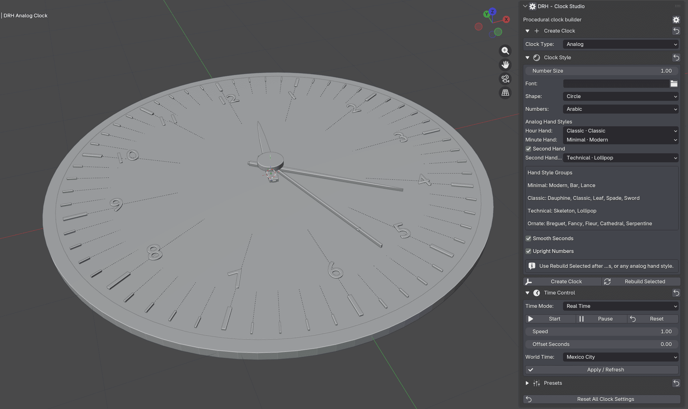

# DRH - Clock Studio

**A clock on a wall beats any amount of mood lighting for telling the viewer what time of day it is.**

  

 

## Where this stands

Built to v1.0.0, development paused. No public download from this repository, no date promised.

If clocks show up in your scenes, say so in an issue with a line about the project. That's what decides whether this comes back before or after the other paused tools.

## What it does

Customizable clock assets for visualization, props, animation, and scene building. Hands, faces, and body geometry generated as editable assets rather than a model you import once and then can't change when the art director wants a different case.

## Who it's for

Interior visualizers who need a clock on the wall that isn't a flat texture. Prop artists dressing a room. Anyone cutting from day to night and needing the hands in a believable position.

## Why it isn't released yet

The released DRH add-ons get the compatibility pass first, and each one of them has open issues from real users. Clock Studio hasn't had that pass, so shipping it now would mean learning about Blender version edge cases from you instead of in my own scene.

[Open an issue](https://github.com/pacosalasv/DRH_Clock_Studio-Support/issues) to move it up the queue.

Released DRH add-ons, all free: [Blender tools on BlendKit](https://www.blendkit.com/?query=category_subtree:addon+author_id:205846) · [DRH Hub](https://github.com/pacosalasv/DRH_Addons_Hub)

  

